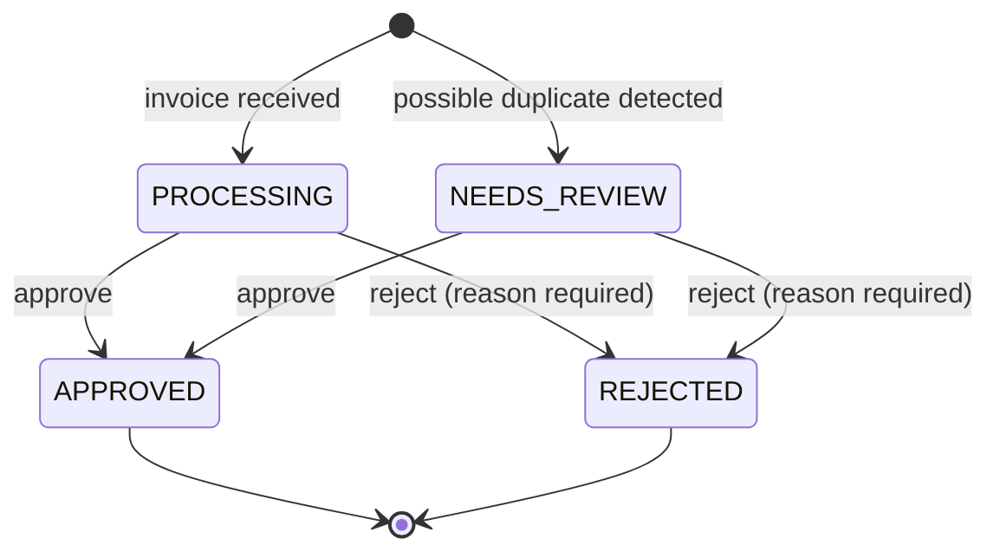

# Schema and status model

## Tables

Postgres (Supabase). `invoice_status` is an enum: `PROCESSING`, `NEEDS_REVIEW`, `APPROVED`, `REJECTED`.

### `invoices`

| Column                      | Type             | Notes                                               |
| ---------------------------- | ---------------- | ---------------------------------------------------- |
| `id`                         | `uuid`           | Primary key                                          |
| `vendor_name`                | `text`           | As received                                          |
| `vendor_name_normalized`     | `text`           | Uppercased, legal suffixes/punctuation stripped      |
| `invoice_number`             | `text`           | As received                                          |
| `invoice_number_normalized`  | `text`           | Uppercased, letters/digits only                      |
| `description`                | `text`, null     |                                                       |
| `amount_cents`               | `bigint`         | Integer cents, never floats. `CHECK (>= 0)`          |
| `currency`                   | `char(3)`        | ISO 4217                                             |
| `invoice_date`, `due_date`   | `date`           | `CHECK (due_date >= invoice_date)`                   |
| `status`                     | `invoice_status` | Default `PROCESSING`                                 |
| `review_reason`              | `text`, null     | Why it was flagged, shown to the reviewer            |
| `duplicate_of_id`            | `uuid`, null     | Self-FK to the original invoice this one may repeat  |
| `decision_note`              | `text`, null     | Reviewer's note; required on rejection               |
| `decided_at`                 | `timestamptz`, null | Set once status reaches a final state             |
| `version`                    | `integer`        | Optimistic-concurrency counter, `+1` on every change |
| `created_at`, `updated_at`   | `timestamptz`    |                                                       |

Indexes: `status` (tab filtering), `(vendor_name_normalized, invoice_number_normalized)` (duplicate lookup), `duplicate_of_id` (reverse link).

### `invoice_status_history`

Append-only audit log, one row per status change (including the first, on arrival).

| Column        | Type                   | Notes                           |
| ------------- | ---------------------- | -------------------------------- |
| `id`          | `bigint identity`      | Primary key                     |
| `invoice_id`  | `uuid`                 | FK → `invoices.id`, cascade     |
| `from_status` | `invoice_status`, null | `null` for the first entry      |
| `to_status`   | `invoice_status`       |                                  |
| `note`        | `text`, null           |                                  |
| `actor`       | `text`                 | `seed` or `reviewer`            |
| `changed_at`  | `timestamptz`          |                                  |

Defined in [`supabase/schema.sql`](../supabase/schema.sql).

## Statuses

| Status         | Meaning                                        | Tab                  |
| -------------- | ----------------------------------------------- | --------------------- |
| `PROCESSING`   | Received, nothing suspicious, awaiting decision | Processing            |
| `NEEDS_REVIEW` | Flagged — currently: possible duplicate         | Needs review          |
| `APPROVED`     | Final — cleared for payment                     | Approved / Rejected   |
| `REJECTED`     | Final — not to be paid, reason recorded         | Approved / Rejected   |

The transition rule lives in one place, [`src/lib/status.ts`](../src/lib/status.ts), and both the API and the UI read it — the UI hides Approve/Reject on a terminal invoice (`isTerminal()`), the API refuses the transition even if called directly.

## Rules enforced on a status change

All enforced inside one Postgres function, `update_invoice_status` (see `supabase/schema.sql`), so the status update and its audit row are a single atomic transaction:

1. **Legal transition only** — `APPROVED`/`REJECTED` are final; anything else attempting a transition out of them is rejected (`409 INVALID_TRANSITION`, with the allowed next statuses listed).
2. **Rejections require a reason** — enforced both in the request schema (`400 VALIDATION_ERROR`) and implicitly by the data model (`decision_note` shown wherever a rejection is displayed).
3. **Concurrency safety** — the invoice row is locked (`SELECT … FOR UPDATE`) inside the transaction, so two simultaneous decisions on the same invoice serialize instead of racing. The client also sends the `version` it last loaded; a mismatch returns `409 VERSION_CONFLICT` rather than silently overwriting another reviewer's decision.
4. **Atomic audit** — the status row and its history entry are written together or not at all.

## Duplicate detection

Runs at ingestion (the seed script uses the same normalization + matching logic the live app would use: [`src/lib/duplicate-detection.ts`](../src/lib/duplicate-detection.ts)).

- **Key**: normalized vendor name + normalized invoice number — invoice numbers are expected to be unique per vendor, so a repeat is a strong signal even if other fields differ.
- **Normalization** catches formatting differences: `INV-1001` = `inv 1001`; `Acme Supplies Ltd.` = `ACME Supplies Limited`.
- **Fuzzy matching** catches typos, not just formatting: edit distance (via [`fastest-levenshtein`](https://www.npmjs.com/package/fastest-levenshtein)) is computed between the normalized values and an existing invoice. A vendor name within 2 edits *and* an invoice number within 1 edit of an existing invoice is flagged too — e.g. `INV-1002` vs. an existing `INV-1001` — not just an exact match. Both fields must be close; a typo'd invoice number from a clearly different vendor is not flagged.
- **Outcome**: the new invoice is seeded as `NEEDS_REVIEW` instead of `PROCESSING`, with `duplicate_of_id` pointing at the earlier match and `review_reason` explaining why — worded differently for an exact match ("same vendor and invoice number") vs. a fuzzy one ("closely match, possible typo").
- **Never auto-rejected** — a human decides; the detail view links both invoices together.

**Known limit**: edit distance here is classic Levenshtein, which counts a transposition (e.g. `1001` → `1010`) as 2 edits, not 1 — so that specific typo pattern falls outside the invoice-number threshold of 1. Raising the threshold would catch it but increase false positives on short codes; left as a deliberate tradeoff.

Not covered (deliberately out of scope): same-vendor/same-amount/different-number checks within a date window.
